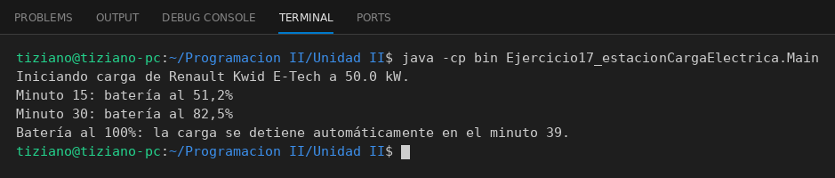

# SurtidorElectrico

Programación II - Unidad 2 - Ejercicio 17

## Consigna
Un surtidor entrega energía a un vehículo eléctrico minuto a minuto hasta el fin de la sesión o la batería llena.

## Lógica
- `VehiculoElectrico`: `capacidadBateria` y `nivelActual`; `recibirCarga(kw)` suma energía sin superar la capacidad.
- `SurtidorElectrico.iniciarCarga(vehiculo, minutos)`: en cada minuto envía `potencia / 60` de energía y se detiene automáticamente si el vehículo llega al 100%.
- Imprime el porcentaje cada 15 minutos.
- `Main`: vehículo con 8 de 40 kWh conectado a un surtidor de 50 kW.

## Ejecución

